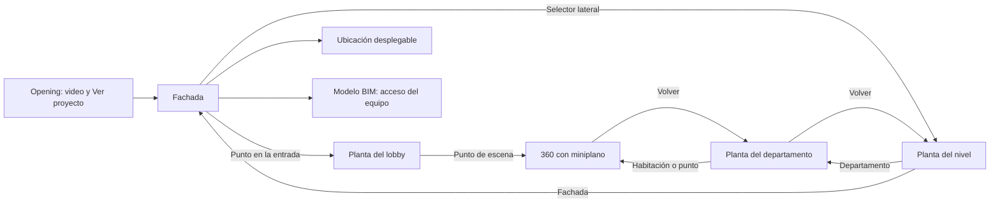

# AgelArq: showroom inmersivo y correcciones de almacenamiento

Fecha: 14 de octubre de 2026.
Estado: diseño concreto para revisión del propietario; implementación pendiente.
Base: `origin/main`, commit `41c6b042d4f31a351d860d0a4f2a3971ba1208b5`.
Rama de trabajo: `codex/showroom-inmersivo`.

## 1. Resultado solicitado

Crear una página web comercial que use los renders, plantas y recorridos del proyecto como navegación principal, con la misma identidad de AgelArq. El propietario configura el contenido desde el panel; el visitante no ve herramientas administrativas.

El propietario autorizó comenzar las correcciones de escenas por espacio y trabajo con archivos locales, y añadir Opening sin Ending, fachada interactiva, entrada al lobby, selector de niveles, plantas, departamentos, miniplano y accesos a ubicación y modelo BIM.

Decisión confirmada por el propietario: el acceso BIM será únicamente para el equipo con cuenta y permisos del proyecto. El showroom público no recibirá acceso al modelo técnico.

El motor 360 existente se conserva. Se cambia la experiencia del showroom y la integración de archivos; no se rediseñan sus controles internos ni se repiten pruebas manuales del visor anterior, según la instrucción del propietario.

## 2. Recorrido y distribución visibles



En escritorio, la página se distribuye así:

```text
┌───────────────────────────────────────────────────────────┐
│ AGELARQ    Nombre del proyecto          Información Contacto│
├────────────┬──────────────────────────────────────────────┤
│ Fachada    │                                              │
│ Lobby      │              RENDER / PLANTA                  │
│ Nivel 1    │                                              │
│ Nivel 2    │       zonas seleccionables                    │
│ Nivel 3    │       entrada al lobby                        │
│ ...        │                                              │
│            │                                              │
│ Ubicación  │  Fachada › Nivel 1 › Departamento 101          │
│ Modelo BIM │                  [Miniplano al entrar al 360] │
└────────────┴──────────────────────────────────────────────┘
  Información comercial, galería y contacto disponibles
  como contenido web, con enlaces y títulos accesibles.
```

El lateral pertenece al showroom. El miniplano aparece en la parte inferior derecha del recorrido para no tapar los accesos de la izquierda. En móvil, niveles y herramientas se abren desde controles compactos y el miniplano se puede plegar.

### 2.1 Opening

- Video opcional a pantalla completa con nombre, subtítulo y botón configurable «Ir» o «Ver proyecto».
- No existe Ending. Terminar el video mantiene la portada y el botón; no cierra el showroom ni salta de escena por sorpresa.
- El botón lleva siempre a la fachada configurada, sin abrir el recorrido 360 de inmediato.
- Reproducción automática solo si el navegador la permite; sin sonido por defecto, con control explícito para activarlo. El botón funciona aunque el video no cargue.
- Imagen de portada como respaldo. Sin video configurado, se entra directamente a la fachada.
- El panel permite activar/desactivar Opening, seleccionar video local o URL HTTPS, portada, textos y nombre del botón.
- Volver desde una planta conserva la fachada; no obliga a repetir el video. Un enlace directo a una unidad o escena abre ese destino y permite ir a la fachada.

### 2.2 Fachada y entrada

- Render principal con proporciones conservadas. Los puntos y contornos se posicionan respecto a la imagen, incluso cuando aparecen márgenes en pantalla.
- Punto de entrada configurable sobre la puerta: título «Entrar al lobby» y destino obligatorio a la vista de planta del lobby.
- Los contornos de niveles pueden resaltar al pasar el cursor o recibir foco. Seleccionarlos abre su planta, igual que el selector lateral.
- El lateral muestra únicamente niveles reales del edificio activo, con orden configurable y estado seleccionado. Cambiar de edificio cambia el lateral.
- No se deduce un nivel a partir del nombre del departamento ni de una región dibujada: cada asociación queda registrada por ID.

### 2.3 Plantas y departamentos

- Cada planta se asocia explícitamente a un edificio, nivel o unidad del catálogo.
- Las zonas de departamentos abren su planta individual cuando existe. En ausencia de planta individual se abre la ficha con acceso al recorrido, sin inventar un plano.
- Una zona de habitación puede llevar a una escena configurada; un punto 360 permite el mismo acceso sin crear habitaciones en el catálogo.
- Mostrar nombre, disponibilidad y datos comerciales configurados. Los precios siguen ocultos cuando no se autoriza publicarlos.
- Mantener ubicación del visitante: fachada, nivel, departamento y escena; «Volver» recupera el contexto anterior.

### 2.4 Recorrido y hotspots

- Abrir el motor 360 compartido mediante la interfaz existente de `PanoEngine`.
- Mostrar automáticamente el miniplano del departamento asociado y sus puntos de escena. En un recorrido común, usar la planta del lobby o nivel correspondiente.
- El selector de escenas y el miniplano respetan el alcance del espacio. Un departamento no muestra escenas de otro porque ambos pertenezcan al mismo proyecto.
- Los puntos muestran nombre al enfocarse, son botones accesibles y tienen área táctil de al menos 44 px.
- Estilo coherente con AgelArq: marcadores sobrios, acento arena y estado activo evidente. Los puntos sobre fachada/planta son anclas 2D de la imagen.
- Para hotspots de navegación sobre suelo en 360, añadir una capa de presentación propia del showroom con orientación configurable de superficie y apariencia en perspectiva. No cambiar el formato de coordenadas ni el motor del visor anterior. Mantener representación plana como respaldo para datos antiguos y evitar prometer geometría real de la habitación a partir de una panorámica.

### 2.5 Ubicación y BIM

- «Ubicación» abre un panel lateral con dirección, notas de acceso y enlace al mapa ya configurados. El mapa externo solo se abre por acción del visitante; no se descarga una integración de mapas al entrar al showroom.
- «Modelo BIM» se sitúa abajo a la izquierda. Lleva al visor web de la versión autorizada procedente de Navisworks; no intenta ejecutar el programa de escritorio desde una web.
- Mostrar el acceso BIM solo al equipo autenticado con permiso del proyecto. Comprobarlo también en servidor; ocultar el botón no reemplaza RLS. No modificar permisos anónimos ni incluir tokens, URNs o propiedades técnicas privadas en el manifiesto público.
- Guardar el contexto del showroom para volver a la fachada o planta después de consultar BIM.
- Mantener filtros por disciplina, sistema, nivel y etapa. Añadir vistas predefinidas «Completo», «MEP», «Con acabados» y «Obra gris» configuradas para cada modelo.
- «MEP» combina las disciplinas seleccionadas; no se implementa como condiciones de igualdad incompatibles. «Con acabados» y «Obra gris» dependen de categorías, conjuntos o reglas reales del modelo. No basta con cambiar el color del visor ni se inventa clasificación cuando faltan datos.
- Sin modelo listo, credenciales APS o funciones desplegadas, el panel muestra qué falta y no ofrece un acceso roto. No iniciar conversiones de Autodesk ni servicios de pago automáticamente.

## 3. Identidad visual y movimiento

Autoridad visual: `index.html` y `packages/ui/base.css`. El showroom actual usa una paleta clara propia que se sustituirá para cumplir la identidad que pidió el propietario.

- Fondo `#0D0D0D`, texto `#EFEFEF`, acento arena/dorado `#B89D74`, bordes claros discretos y paneles oscuros translúcidos.
- Tipografía Inter; Geist o Geist Mono solo para datos y claves donde ya corresponda. Logo y nombre existentes; no inventar marca ni texto comercial.
- El render y las plantas dominan la composición. El panel lateral conserva controles legibles sobre imágenes claras y oscuras.
- Interacciones breves de 120–180 ms; paneles de 220–320 ms; cambios de vista de 400–550 ms, con la curva AgelArq `cubic-bezier(.22,1,.36,1)`.
- Opening → fachada: retirada del texto y fundido con escala sutil de la fachada. Fachada → planta: mantener contexto y resaltar el nivel seleccionado. Planta → 360: transición corta una vez que el recurso esté listo.
- Cancelar transiciones anteriores al navegar rápido. No acumular videos, imágenes decodificadas ni instancias del visor en segundo plano.
- Con movimiento reducido, cambios inmediatos o fundidos mínimos. Todas las funciones siguen disponibles con teclado y lector de pantalla.

## 4. Corrección del alcance de escenas y catálogo

En el editor de cada vista se incorpora «Esta vista corresponde a»: proyecto, edificio, nivel o departamento. El alcance deriva del espacio elegido y sus descendientes.

- Una planta de departamento ofrece la unión de sus escenas vinculadas; una planta de nivel ofrece las de las unidades de ese nivel; una fachada puede tener alcance del edificio.
- Si no hay escenas vinculadas, mostrar el motivo y un acceso para configurarlas; no volver a ofrecer todas silenciosamente.
- Un mismo punto puede representar una escena compartida cuando la asociación es válida.
- Cambiar el alcance no elimina puntos sin aviso. Los puntos incompatibles se marcan para corregir y la revisión previa evita publicarlos como destinos válidos.
- Vistas antiguas sin alcance conservan su comportamiento de proyecto hasta que el propietario elija un espacio. No reasignarlas por coincidencias de nombres.
- Añadir una columna opcional `nivel` al importador CSV para crear edificio → nivel → departamento. Los CSV actuales sin esa columna mantienen su comportamiento.
- Las claves de unidades deben ser únicas dentro del proyecto; detectar duplicados dentro del CSV antes de escribir. Importar dos edificios con «Nivel 1» crea niveles diferentes bajo sus respectivos edificios.

## 5. Trabajo local y subida explícita

La política objetivo es local primero. Agregar medios, iniciar sesión o guardar un borrador local no sube sus archivos a Supabase.

1. «Agregar archivo local»: selecciona y registra el archivo en el dispositivo.
2. «Guardar en este dispositivo»: conserva borrador y medios locales.
3. «Subir a la nube»: calcula el conjunto pendiente y muestra sus bytes y límites. Solo una acción explícita inicia las subidas.
4. «Crear versión» y «Publicar»: usan un conjunto de recursos ya accesibles. Bloquean una publicación incompleta e indican qué archivos siguen locales.

### Persistencia y archivos grandes

- Identificadores locales estables; nunca persistir un `blob:` temporal como dirección definitiva del archivo.
- Almacenamiento de medios en disco administrado por el navegador; metadatos pequeños separados. Comprobar cuota y solicitar persistencia cuando esté disponible. Usar el almacenamiento local existente como puente de compatibilidad.
- Los límites del bucket no se aplican al original local. El tamaño admisible depende del espacio, el formato y la capacidad del dispositivo. Mostrar límites reales; no anunciar «ilimitado».
- Para archivos muy grandes, evaluar lectura por partes y acceso a carpeta autorizada donde exista soporte, con alternativa compatible. No convertir todo un video o proyecto a base64 en memoria.
- Respaldo exportable. Manejar falta de espacio, limpieza de datos del navegador, permisos revocados y archivo movido sin perder silenciosamente el borrador.
- Mantener originales y versiones de publicación separados. Ofrecer imágenes optimizadas y portadas ligeras; videos con URL HTTPS ya alojada también son válidos. No añadir transcodificación de video de pago ni subir automáticamente el original.
- Estado por archivo: local, pendiente, subiendo, disponible en nube o error. Subidas reintentables sin duplicados. La pausa se ofrece entre archivos si el proveedor no admite reanudación del archivo; no prometer reanudación por bytes sin soporte.
- Conservar presupuesto global de 800 MB y máximos actuales de los buckets. No ampliar el plan ni abrir la subida pública antigua. Un archivo que no cabe en nube puede seguir usándose localmente si el dispositivo lo permite.
- El primer acceso de un cliente necesita recursos alojados. La caché del propietario no publica archivos y la caché del cliente no elimina todo consumo de transferencia.
- Los borradores locales son específicos del dispositivo y usuario de la app. No cargar borradores de otra cuenta al cambiar de sesión; no borrar originales al cerrar sesión sin una acción del propietario.

## 6. Datos, compatibilidad y módulos

Separar datos de autoría, estado temporal de navegación y manifiesto publicado. Conservar IDs entre panel y publicación; no usar índices de arrays para los destinos persistidos.

Extensiones propuestas a `projects.showroom`:

- `experience.version`: versión del formato nuevo.
- `opening`: habilitado, referencia al video y portada, título, subtítulo y botón; sin Ending.
- `experience.facadeViewId`, `experience.entryTargetViewId` y entrada con posición y etiqueta.
- En cada vista: `spaceId`, función fachada/planta, imagen y destinos de sus zonas; la imagen puede existir sin zonas.
- Referencia BIM privada elegida en configuración del proyecto; no serializarla al manifiesto anónimo. Obtener acceso al destino por una ruta/RPC autenticada.
- Las referencias locales de medios se resuelven en el dispositivo. La sincronización crea una copia nube coherente; los manifiestos públicos solo contienen recursos accesibles por HTTPS.

Módulos de responsabilidad concreta:

| Responsabilidad | Ubicación prevista |
|---|---|
| Navegación fachada/nivel/unidad y recuperación de contexto | Nuevo módulo de experiencia del showroom |
| Reglas de alcance, vínculos y rutas | Módulo compartido entre panel, validación y showroom |
| Almacenamiento local y resolución de medios | Módulo compartido de medios locales |
| Sincronización explícita y registro de pendientes | Integración con `packages/core/cloud.js` |
| Opening, destinos y asociación de vistas | Editor del panel separado de su archivo principal |
| Shell visual y transiciones | Estilos y controlador del showroom |
| Autorización BIM y presets reales | Adaptador/visor BIM y RPC autenticada cuando corresponda |

No crear otra copia del motor 360. El código de publicación y el generador estático consumen el mismo manifiesto validado.

Límites detectados: `sanitizeShowroom` conserva solo ocho vistas y descarta las imágenes sin puntos o zonas. Reemplazar el límite de ocho por un límite explícito de 256 vistas, suficiente para la fachada, niveles y plantas de departamentos del ejemplo. Rechazar el exceso con un mensaje visible; no truncar datos silenciosamente. Conservar los demás límites de cantidad hasta que un caso real justifique ampliarlos, con validación consistente en panel y servidor.

Actualizar el esquema compartido y la construcción del snapshot SQL cuando haga falta. Toda modificación de Supabase será una migración nueva después de las doce existentes; no repetir la instalación inicial. Mantener las versiones publicadas anteriores inmutables y los enlaces históricos.

## 7. Estados incompletos y seguridad

- Sin fachada: el panel indica cómo elegirla; una publicación nueva con experiencia inmersiva no se anuncia lista. Las publicaciones antiguas siguen usando su presentación anterior hasta disponer de configuración nueva válida.
- Sin planta del nivel: nivel visible con explicación, sin navegar a otra planta por error.
- Sin escena del departamento: conservar su ficha y plano, con recorrido no disponible.
- Error de video: portada y botón funcionales. Error de imagen: aviso y navegación de regreso.
- Video opcional y bajo demanda; detenerlo al salir del Opening. Cargar imágenes del estado actual y miniaturas; evitar precarga masiva del edificio.
- Validar pertenencia de espacios, vistas, escenas y modelos al proyecto; detectar ciclos de navegación y destinos eliminados.
- Revisión de publicación comprueba recursos accesibles, asociaciones y permisos en servidor. No aceptar `javascript:`, rutas de archivos, URLs locales ni medios de borrador como recursos públicos.
- Borrar una zona o desvincular una escena no borra el archivo original de Storage. No eliminar archivos de producción como limpieza de pruebas.

## 8. Enfoque elegido y alternativas

Enfoque recomendado: ampliar la plataforma actual con una experiencia de showroom y módulos compartidos de vínculos y medios. Conserva catálogo, permisos, publicación y motor 360.

Alternativa de cambios visuales solamente: más breve, pero deja sin resolver el vínculo fachada/planta y la separación local/nube; no cumple el encargo.

Alternativa de una aplicación nueva independiente: ofrece aislamiento, pero duplica autorización, catálogo, medios y publicaciones. Añade migración y mantenimiento innecesarios para este proyecto.

El trabajo se divide en entregas verificables: relaciones de vistas/escenas y niveles; persistencia/sincronización local; experiencia pública y Opening; acceso BIM/presets. El plan de implementación debe cubrir todas, sin presentar una entrega parcial como el showroom completo.

## 9. Comprobaciones y aceptación

Las comprobaciones se limitan a los cambios de panel, almacenamiento, publicación y navegación del showroom. Usar fixtures sintéticos pequeños en entorno local. El motor 360 puede sustituirse por un adaptador de prueba para verificar entradas y salidas; no repetir la batería manual del visor existente ni cargar archivos grandes en Supabase.

1. Un archivo local añadido no dispara una subida automática; tras recargar, el borrador recupera referencias válidas.
2. El filtro de escenas del departamento 101 no muestra las del 102. Un nivel incluye sus departamentos, y un alcance vacío no se convierte en todo el proyecto.
3. CSV con `nivel` produce jerarquía correcta; CSV anterior sigue funcionando y duplicados no pisan unidades inesperadamente.
4. Opening → Ver proyecto abre la fachada. Sin video y con reproducción bloqueada el proyecto sigue siendo accesible. No existe Ending.
5. El punto en la entrada abre la planta del lobby. Cada nivel lateral abre su propia planta.
6. Un departamento abre su planta y una habitación o punto abre su escena vinculada. Volver restaura el nivel y departamento anteriores.
7. El miniplano correcto aparece al entrar al recorrido y sus puntos respetan el alcance. No se modifica el motor anterior.
8. Ubicación usa información real configurada. Un visitante anónimo no recibe acceso ni datos privados del modelo BIM; un miembro autorizado puede abrir la versión configurada y regresar al showroom.
9. Los presets BIM se validan con conjuntos de elementos reales o fixtures de clasificación. Una clasificación ausente se informa; no se simula una vista de obra gris como si fuera real.
10. No hay recortes ni controles superpuestos en escritorio y móvil. Navegación por teclado, foco, contraste y movimiento reducido funcionan.
11. La publicación rechaza recursos pendientes/locales y conserva las versiones y enlaces existentes. No hay aumento de cuotas ni cambio de plan.

## 10. Preparación del propietario

El panel nuevo permitirá cargar los recursos reales; no es necesario compartir credenciales en el chat. Para completar un proyecto se necesitan video y portada opcionales, render de fachada, plantas por nivel, plantas por departamento cuando existan y escenas vinculadas. BIM requiere una versión de modelo autorizada y la configuración APS pendiente. El desarrollo de interfaz puede avanzar con fixtures locales, pero no se afirmará una integración real de Autodesk sin esas credenciales y un modelo listo.

## 11. Punto de revisión

Este documento concreta lo solicitado y la decisión de BIM privado. Falta la revisión del propietario antes del plan de implementación y los cambios de producto, conforme al flujo de la habilidad `brainstorming`. La rama contiene solo documentación en esta etapa; no modifica el sitio publicado ni Supabase.
